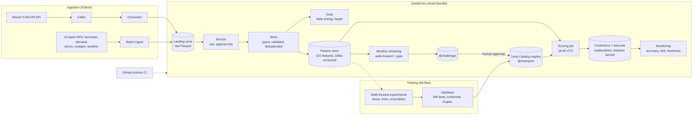

# Electricity Pulse

[](https://github.com/ngin10/electrcity_pulse/actions/workflows/ci.yml)
[](https://ngin10.github.io/electrcity_pulse/)
[](https://ngin10.github.io/electrcity_pulse/)
[](https://ngin10.github.io/electrcity_pulse/)
[](https://ngin10.github.io/electrcity_pulse/)

**An end-to-end MLOps project: a day-ahead forecast of how much of Great Britain's electricity will come from
renewables, from raw APIs to a monitored model in production.**

Kafka and API ingestion → a Delta lakehouse on Databricks → a versioned feature store → MLflow-tracked
experiments → a registered champion → a scheduled scoring job with explanations → accuracy and drift
monitoring, all tested and deployed through CI.

| | |
|---|---|
| **The question** | At 18:00 UTC today, what share of GB generation will wind, hydro and biomass supply tomorrow? |
| **The model** | An equal blend of Bayesian ridge and LightGBM, on 131 features known by the cutoff |
| **Accuracy** | MAE **3.30 points** out of sample (95% CI 3.12–3.54; R² 0.907) over 674 days, against 4.47 for the baseline |
| **Uncertainty** | A conformal 80% interval: 78.2% coverage, statistically consistent with 80% (Kupiec p = 0.28) |
| **Evidence** | [Model validation report](docs/model_validation_report.md) · [Model card](docs/model_card.md) |
| **Live status** | [**ngin10.github.io/electrcity_pulse**](https://ngin10.github.io/electrcity_pulse/): rebuilt daily from the deployment |

## The model in production, today

These charts are redrawn every evening from the Databricks deployment by
[`model-status.yml`](.github/workflows/model-status.yml), so they show the model as it is now, not as it was at
commit time. The [status page](https://ngin10.github.io/electrcity_pulse/) adds the monitoring results, the latest
retraining gate and the registry.

<picture>
  <source srcset="https://ngin10.github.io/electrcity_pulse/forecast-dark.svg" media="(prefers-color-scheme: dark)">
  
</picture>

<picture>
  <source srcset="https://ngin10.github.io/electrcity_pulse/accuracy-dark.svg" media="(prefers-color-scheme: dark)">
  
</picture>

Before the "live scoring" line, the history is the retraining job's walk-forward. Each day there was predicted by
a model refitted monthly on earlier days only, so it is out of sample too. The two spells above the alert level
(December 2025 and August 2026) are the turbulent weeks the [model card](docs/model_card.md) warns about.

## Architecture



## The MLOps lifecycle, and where each part lives

| Stage | What it does | Where |
|---|---|---|
| **Ingestion** | Every record and revision landed raw and append-only; at-least-once delivery, compaction-safe keys | `main.py`, `consumer/`, `batch_ingest/` |
| **Data quality** | Explicit per-source contracts; hard rules reject to a quarantine table, soft rules warn; completeness per day | [`quality.py`](databricks/src/pulse/quality.py), [`sources.py`](databricks/src/pulse/sources.py) |
| **Features** | 131 features, each using only data published by 18:00 UTC the day before (a leakage rule per source) | [`pulse/feature_store.py`](databricks/src/pulse/feature_store.py) |
| **Data versioning** | The feature store is a Delta table with a year of time travel: change-only writes, a hash per row, the feature-set version and Git commit on every row | [`notebooks/feature_store.py`](databricks/src/notebooks/feature_store.py) |
| **Experiments** | Linear, tree and ensemble suites; monthly walk-forward refits; every parameter, metric, chart and model in MLflow | [`eda/train_*.py`](eda/), [`eda/experiment.py`](eda/experiment.py) |
| **Model selection** | Diebold–Mariano tests with HAC errors, block-bootstrap confidence intervals, a 2026 holdout | [`eda/train_ensembles.py`](eda/train_ensembles.py), [validation report](docs/model_validation_report.md) |
| **Uncertainty** | A conformal 80% interval, checked with Kupiec and Christoffersen tests | [`eda/calibrate_intervals.py`](eda/calibrate_intervals.py) |
| **Packaging and registry** | One pyfunc (prediction + interval) with pinned dependencies, registered in Unity Catalog as `@champion` | [`eda/champion_model.py`](eda/champion_model.py), [`package_champion.py`](eda/package_champion.py) |
| **Retraining and promotion** | Monthly job: refits the champion's own specification on the latest features, recalibrates the interval, applies a promotion gate, registers `@challenger`; a person promotes it (or rolls back), with `@previous_champion` kept | [`notebooks/train_day_ahead.py`](databricks/src/notebooks/train_day_ahead.py), [`pulse/training.py`](databricks/src/pulse/training.py), [`notebooks/promote_model.py`](databricks/src/notebooks/promote_model.py) |
| **Serving** | Batch scoring after the cutoff. Stores the exact features served and an exact per-feature explanation of every prediction; flags days with missing weather and widens their interval | [`notebooks/score_day_ahead.py`](databricks/src/notebooks/score_day_ahead.py) |
| **Monitoring** | Rolling accuracy and coverage; feature and prediction drift against the same season; source freshness | [`notebooks/monitor_day_ahead.py`](databricks/src/notebooks/monitor_day_ahead.py), [`pulse/monitoring.py`](databricks/src/pulse/monitoring.py) |
| **Public status** | A daily GitHub Action reads the registry, MLflow and the monitoring tables and publishes charts, badges and a status page to GitHub Pages | [`model-status.yml`](.github/workflows/model-status.yml), [`tools/model_status.py`](databricks/tools/model_status.py) |
| **CI/CD** | Lint, unit, Spark and model tests, combined coverage, Bandit, pip-audit, gitleaks, bundle validation; deployed with Databricks Asset Bundles | [`ci.yml`](.github/workflows/ci.yml), [`databricks/`](databricks/README.md) |

## Design decisions worth asking about

- **Batch scoring, not a real-time endpoint.** The forecast is for one known day, from inputs fixed at a cutoff,
  so the answers belong in a table, written once a day with their inputs and explanations. An endpoint would
  recompute what is already stored.
- **Leakage is a contract, not a hope.** Every source has an availability rule (its publish time, or a
  documented assumption where the feed has none), and every feature is cut at 18:00 UTC on the day before.
- **Walk-forward, not a random split.** The model is refitted monthly from January 2025 and judged only on days
  after each refit, as it would be used.
- **Drift that doesn't cry wolf.** The textbook rule (PSI above 0.25 against the training year) raised 92 false
  alarms in a dry run: seasons look like drift, and 30 days are too few for that threshold. Comparing against
  the same season, with thresholds from a block bootstrap, left 17 genuine shifts (solar capacity, nuclear
  outages, prices doubling), none of which hurt accuracy. So drift is recorded, and accuracy decides retraining.
- **Retraining that can't change the design.** The monthly job clones the registered champion's specification,
  so only the data is new. Retrained on the same data, it reproduces the validated model exactly (walk-forward
  MAE 3.303, interval ±5.363, identical predictions). A gate, not a race against the champion, decides whether
  it may replace it, and a person approves the swap.
- **Honest limitations.** Interval misses come in runs, very windy days are under-predicted by about 3 points,
  and missing weather doubles the error. Each is measured and written up in the
  [validation report](docs/model_validation_report.md).

## Where to start reading

1. The [model card](docs/model_card.md), then the [validation report](docs/model_validation_report.md).
2. [`databricks/README.md`](databricks/README.md): the lakehouse, feature store, scoring and monitoring.
3. [`.github/workflows/ci.yml`](.github/workflows/ci.yml): what every push has to pass.
4. The sections below: ingestion, from the APIs to the landing zone.

## Ingestion

```
┌────────────┐   ┌──────────────┐   ┌──────────┐   ┌────────────────────┐   ┌──────────────────────────┐
│ Elexon     │──►│ producer     │──►│  Kafka   │──►│ consumer           │──►│ gs://<bucket>/landing/   │──► Databricks
│ FUELHH API │   │ python main  │   │ (Docker) │   │ python -m consumer │   │   fuelhh/                │
└────────────┘   └──────────────┘   └──────────┘   └────────────────────┘   │   <batch source>/        │
┌────────────────────────────────────────┐   ┌───────────────────────┐      │                          │
│ demand, wind forecasts, carbon, solar, │──►│ batch ingest          │─────►│                          │
│ NESO embedded generation, weather      │   │ python -m batch_ingest│      └──────────────────────────┘
└────────────────────────────────────────┘   └───────────────────────┘
```

Every half-hour, Elexon publishes how much electricity each fuel type (wind, gas, nuclear, interconnectors
and so on) supplied to the GB grid, and revises those figures later. This repo gets every record, including
every revision, into GCS unchanged, along with the demand, solar, carbon and weather data that explain it.

### Batch sources

Fetched by date range and landed as received, one row per API response. Every endpoint, request limit and
history depth here was checked against the live APIs.

| Landing table | What it holds | Per request | History |
|---|---|---|---|
| `elexon_demand_outturn` | National demand (INDO, ITSDO), half-hourly | 7 days | 2023 and earlier |
| `elexon_wind_forecast` | Elexon wind generation forecasts (WINDFOR), every publish | 7 days | 2023 and earlier |
| `carbon_intensity` | Carbon intensity, forecast and actual, half-hourly | 14 days (API max 31) | 2023 and earlier |
| `pv_live` | Sheffield Solar PV_Live national solar estimate, half-hourly | 31 days | 2023 and earlier |
| `neso_historic_demand` | NESO demand, embedded wind and solar, interconnector flows | 31 days | 2004 onward; published ~3 weeks behind |
| `weather_forecast_day_ahead` | Open-Meteo forecasts as made the day before, at 5 UK wind/solar points | 31 days | from 2024-03 |
| `weather_historical_forecast` | Open-Meteo stitched short-range forecasts, same points | 31 days | 2021 onward |
| `elexon_demand_forecast` | National demand forecast (NDF), only the publishes 17:00-18:00 UTC: each covers all of the next day | 1 day (API max) | 2023 and earlier |
| `elexon_wind_solar_forecast` | Day-ahead wind and solar generation forecasts (DGWS) | 7 days (API max) | 2023 and earlier |
| `elexon_wind_solar_actual` | Actual wind and solar generation (AGWS) | 7 days (API max) | 2023 and earlier |
| `elexon_system_prices` | System (imbalance) prices and volumes | 1 day, date in the URL path | 2016 and earlier |
| `elexon_market_index` | Wholesale market index price and volume (MID); `APXMIDP` has the prices, `N2EXMIDP` is mostly zero | 7 days (API max) | 2023 and earlier |
| `elexon_remit_outages` | Power-station outage and unavailability notices, with details | 1 day (API max) | 2023 and earlier |
| `uk_bank_holidays` | Bank holidays for England & Wales, Scotland and Northern Ireland | one snapshot per run | 2019 onward |

For a day-ahead model, train on what was known the day before: `weather_forecast_day_ahead`,
`elexon_demand_forecast` and `elexon_wind_solar_forecast`. The stitched weather series and the actuals are
what really happened, which a model won't have when it predicts, so they suit exploration and targets rather
than features.

Columns: `raw_value` (the response body), `source`, `request_url`, `window_from`, `window_to` (the days
requested), `http_status`, `fetched_at` (ISO UTC; also sets `ingest_date`). Each run re-fetches the last
few days of every source, since sources revise recent data, so readers deduplicate on the record's own key
and keep the latest `fetched_at`.

### Landing files

`<LANDING_PATH>/fuelhh/ingest_date=YYYY-MM-DD/part-<uuid>.parquet`, append-only. One row per Kafka message:

| Column | Type | Meaning |
|---|---|---|
| `raw_value` | string | The message exactly as published: an envelope with `schema_version`, `source`, `dataset`, `ingested_at`, `fetch_window` and the Elexon record in `payload` |
| `kafka_topic`, `kafka_partition`, `kafka_offset` | string, int64, int64 | Where the message sits in Kafka; together they identify it uniquely |
| `kafka_key` | string | The record's identity (hash of date, period and fuel type) |
| `kafka_timestamp_ms` | int64, nullable | When Kafka received the message |
| `consumed_at` | string (ISO, UTC) | When the consumer read the batch; also sets `ingest_date` |

### Ingestion design decisions

- **Raw all the way to GCS.** Neither the producer nor the consumer filters or changes records: every record
  from Elexon is published and landed as-is. Data-quality checks belong downstream, so a rule change needs no
  redeploy here and can be re-applied to everything already landed.
- **A landing zone between Kafka and the lakehouse.** Ingestion and processing are decoupled: the consumer is
  small and cheap, Kafka never has to be reachable from the cloud, and the lakehouse can be rebuilt from the
  raw files at any time.
- **Kafka keys that survive compaction.** The topic is compacted (Kafka keeps the latest value per key), and
  a record's key is its identity: date, period and fuel type, so a revision replaces the older value. A broken
  record missing part of that identity is keyed by its whole content instead, so compaction can't collapse
  unrelated bad records into one before they are landed.
- **At-least-once delivery.** Kafka offsets are committed only after a file is safely stored. A crash replays
  the batch into a new file, so downstream deduplicates on the record key (or on topic, partition and offset).
- **Fixed file schema.** Every landing file has the same column types, whatever the batch contains, so a
  reader such as Auto Loader never sees a column change type between files.
- **No partial files.** Locally, files are written to a temp name and renamed; in GCS, an object only becomes
  visible once its upload completes.

## Running it

```
pip install -r requirements.txt
docker compose up -d          # Kafka
python main.py                # Elexon -> Kafka
python -m consumer --once     # Kafka -> LANDING_PATH (default: data/landing)
```

### Landing in GCS

The consumer writes as a dedicated service account that can **only create objects** in the bucket: it can't
read, list, overwrite or delete them, so append-only is enforced by GCS, not just by the code. There is no key
file: you sign in once and the consumer impersonates the service account.

One-time setup (`<project>`, `<bucket>` and the account name are yours):

```
gcloud iam service-accounts create pulse-consumer

# The consumer's only permission: create objects in this bucket
gcloud storage buckets add-iam-policy-binding gs://<bucket> --member="serviceAccount:pulse-consumer@<project>.iam.gserviceaccount.com" --role="roles/storage.objectCreator"

# Let your own account act as the service account, then sign in as it
gcloud iam service-accounts add-iam-policy-binding pulse-consumer@<project>.iam.gserviceaccount.com --member="user:<your-email>" --role="roles/iam.serviceAccountTokenCreator"
gcloud services enable iamcredentials.googleapis.com
gcloud auth application-default login --impersonate-service-account=pulse-consumer@<project>.iam.gserviceaccount.com
```

Each run (PowerShell):

```
$env:LANDING_PATH = "gs://<bucket>/landing"
python -m consumer --once
```

Impersonation is used instead of a key file because downloadable keys are a common source of leaks, and new
Google Cloud organisations block them by default. A key file still works: set `GOOGLE_APPLICATION_CREDENTIALS`.

### Batch sources

Same `LANDING_PATH` and the same service account; no API keys are needed.

```
python -m batch_ingest --list                       # the sources
python -m batch_ingest                              # every source, caught up to today
python -m batch_ingest --source carbon_intensity    # just one (repeatable)
```

The first run fetches the last `INITIAL_LOOKBACK_DAYS` (7), or from `BACKFILL_START` if set; later runs
continue from each source's checkpoint in `state/batch/`. A source that fails keeps its checkpoint and the
others still run. To backfill three years, set `$env:BACKFILL_START = "2023-11-01"` before the first run:
about 4,600 requests in total and roughly 600 MB of raw responses (far less once compressed in Parquet),
mostly REMIT notices and wind forecasts. The one-day APIs (NDF, system prices, REMIT) make most of the
requests, so a full backfill takes around an hour.

All settings, with defaults, are in [.env.example](.env.example).

## Project layout

```
main.py, source.py, sink.py     producer: Elexon API -> Kafka
envelope.py                     the envelope the producer wraps each record in
checkpoint.py, config.py        producer state and settings
consumer/                       Kafka -> landing zone (local folder or gs://)
batch_ingest/                   batch sources -> landing zone; sources.py defines what each one requests
landing.py                      the landing-file writer shared by the consumer and batch ingest
tests/                          pytest suite, run by GitHub Actions on every push
databricks/                     bronze, silver and gold pipelines, the feature store, scoring and monitoring jobs
eda/                            exploratory analysis, feature engineering, model training and validation (MLflow)
docs/                           model validation report and model card
pyproject.toml                  lint, coverage and security-scan settings
```

## Testing

`pytest` covers the producer (API paging, raw publishing, compaction-safe keys, delivery failures,
checkpoints), the consumer (landing rows, fixed file schema, append-only storage, object-storage writes,
offset commits) and batch ingest (each source's requests and API limits, NESO's per-year tables, backfill
ranges, checkpoints that only advance after a window is stored).

### Continuous integration

[`.github/workflows/ci.yml`](.github/workflows/ci.yml) runs on every push and pull request:

| Job | What it checks |
|---|---|
| Lint | Ruff (pyflakes, pycodestyle, bugbear; settings in `pyproject.toml`); the workflow and Dependabot files against GitHub's schemas |
| Unit tests | `tests/`: ingestion, consumer, feature store |
| Spark tests | `databricks/tests/`: bronze, silver and gold on a local PySpark with Java 17 |
| Model tests | `eda/tests/`: every linear and tree model, the ensemble, the champion's interval, and an MLflow save-and-load round trip, on the pinned versions the models were pickled with |
| Coverage | Unit and Spark coverage combined; fails below a floor that only goes up |
| Security | Bandit, pip-audit on every requirements file, gitleaks over the whole history |
| Bundle | `databricks bundle validate`, once `DATABRICKS_HOST` and `DATABRICKS_TOKEN` are repository secrets |
| CI passed | Succeeds only if all of the above did: the one check for branch protection to require |

Dependabot proposes dependency and action updates weekly. `pre-commit install` runs the fast checks on each commit.

## What I'd do next

- **Run the model search on Databricks too.** Monthly retraining runs there, but searching for a *new* design
  (the linear, tree and ensemble suites in `eda/`) still runs locally against a local MLflow.
- Check at startup that the consumer can write to the bucket, so a bad key fails immediately.
- Move the consumer onto a small cloud VM or Cloud Run so ingestion runs without a laptop.
